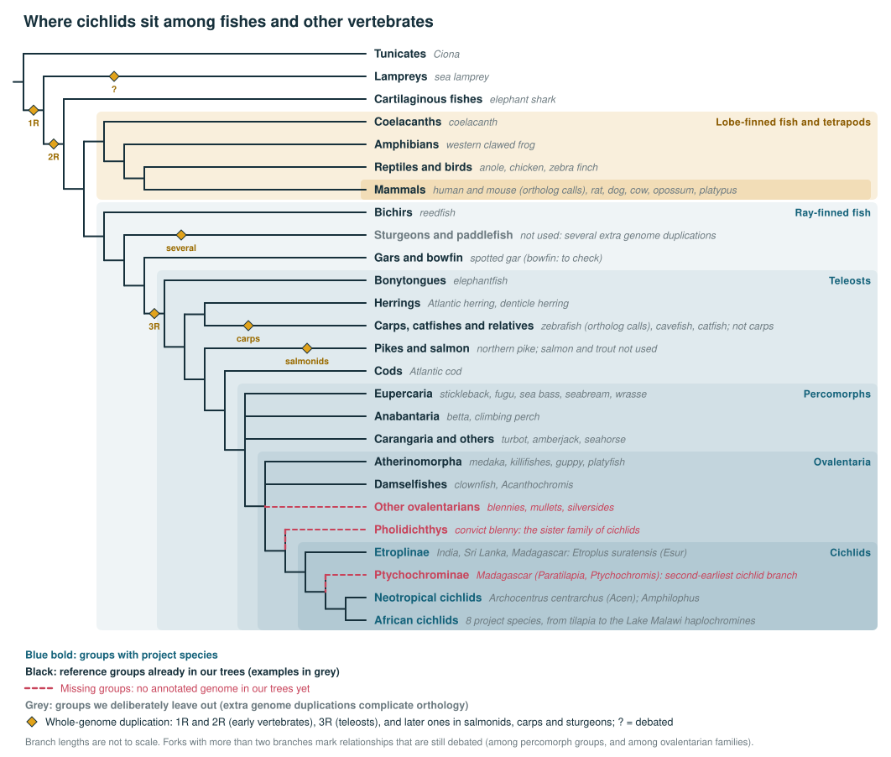

# Species for cichlid gene-tree analyses

*Central Project Coordinator knowledge file. Last updated October 15, 2026.*

This file defines which species any tree-based analysis in the project should include, whatever the method: TreeFam, Ensembl Compara, OrthoFinder, or future approaches. Species fall into three tiers:

1. **Project species:** the cichlids we study, plus the cichlid lineages still missing.
2. **Species for defining cichlid-specific duplications:** the cichlids' nearest relatives (Ovalentaria).
3. **Reference species:** widely used fish models, anchors for the major splits in fish evolution, other vertebrates, and outgroups.

Two columns show what our current trees already contain: **Compara** (our Ensembl Compara reference panel, `compara_panel.tsv`) and **TreeFam 9** (109 genomes from Ensembl release 69 and Ensembl Metazoa 15, 2013). TreeFam 9's fish are zebrafish, cod, stickleback, fugu, *Tetraodon*, medaka, platyfish and tilapia, plus the coelacanth and sea lamprey. Where a genome's availability or annotation is uncertain, the table says **to check**.



The figure shows **groups** rather than individual species, with the species we use listed beside each group. It covers the three tiers below: the cichlid groups with project species (blue), the groups needed to define cichlid-specific duplications (Ovalentaria, including the missing *Pholidichthys*), and the reference groups across fish and other vertebrates. Mammals sit with the coelacanth among the lobe-finned fish, the sister lineage of all ray-finned fish. Diamonds mark whole-genome duplications:

- **1R and 2R,** the two early vertebrate rounds. Current evidence places 1R before lampreys split off and 2R on the branch to jawed vertebrates; the exact timing is still debated. The lamprey lineage may also have had its own genome multiplication (marked "?").
- **3R,** the teleost genome duplication. It's why many cichlid genes have two copies for each human gene (one-to-two orthologs).
- **Later duplications in salmonids, carps and sturgeons.** These lineages had further duplications of their own, which complicate orthology; that's why our trees use pike rather than salmon, zebrafish rather than carp, and no sturgeons (grey).

Forks with more than two branches mark relationships that are still debated.

*Keep `species_phylogeny.svg` in the same folder as this file for the figure to display; `species_phylogeny.png` is the same figure for slides and documents. Both are generated by `make_species_phylogeny.py`: to change the figure, edit the tree in that script and rerun it, rather than editing the SVG by hand.*

## 1. Project species

### Current project species

All annotations come from NCBI RefSeq, downloaded by Stage 1, except *E. suratensis*, which uses the authors' annotation. Of these, only tilapia is also in TreeFam 9 (an older genome version, kept as a separate species).

| Prefix | Species | Lineage | Genome | Why it's included |
|---|---|---|---|---|
| Esur | *Etroplus suratensis* | Etroplinae (India, Sri Lanka) | GCA_041004005.1; proteins from the authors (Katneni et al. 2024) | Earliest-branching cichlid lineage: roots the cichlid tree |
| Acen | *Archocentrus centrarchus* | Neotropical (Heroini) | GCF_007364275.1 (fArcCen1) | Outgroup to the African cichlids |
| Pmar | *Pelmatolapia mariae* | African (Pelmatolapiini) | GCF_036321145.2 | Deep African branch below tilapia |
| Onil | *Oreochromis niloticus* | African (Oreochromini) | GCF_001858045.2 | Best-studied cichlid; outside the East African lake radiations |
| Nbri | *Neolamprologus brichardi* | Lake Tanganyika (Lamprologini) | GCF_056152115.1 | Deepest split within the lake radiations in our set; cooperative breeding |
| Pmic | *Perissodus microlepis* | Lake Tanganyika (Perissodini) | GCF_051167445.1 | Splits the branch to the haplochromines; scale-eater |
| Sdia | *Simochromis diagramma* | Lake Tanganyika (Tropheini) | GCF_900408965.1 | Haplochromine lineage outside the "modern" haplochromines |
| Hbur | *Haplochromis burtoni* | Haplochromini | GCF_018398535.1 | Laboratory model for social behavior and neuroendocrinology |
| Mzeb | *Maylandia zebra* | Lake Malawi (mbuna) | GCF_041146795.1 (Mzebra_GT3a) | Lab's primary reference; browser species; Brawand RNA-seq |
| Acal | *Astatotilapia calliptera* | Lake Malawi | GCF_964374335.1 (fAstCal68.1) | Reference for the Blumer population data; browser species |

### Missing cichlid lineages

These would fill gaps in the cichlid tree. Positions are given relative to the project species.

| Lineage | Example species | Position | Why it matters | Genome status |
|---|---|---|---|---|
| Ptychochrominae (Madagascar) | *Paratilapia polleni*, *Ptychochromis* | Between *Etroplus* and the Neotropical–African split | Second-earliest cichlid split (see below) | Low-coverage draft only (VUQI00000000) |
| Lake Victoria haplochromines | *Pundamilia nyererei* | Within the modern haplochromines, near the Malawi species | Third great lake radiation | Fragmented 2014 assembly; in our Compara trees as reference genes only. Newer assembly: to check |
| Other Lake Tanganyika tribes | Ectodini (e.g. *Ophthalmotilapia*) and others | Within the lake radiations | Fills the Tanganyika radiation, the oldest of the three | Many species sequenced (Ronco et al. 2021), mostly unannotated: to check |
| Other Neotropical groups | Geophaginae, Cichlasomatini (e.g. discus, *Symphysodon*) | Neotropical, beside the Heroini | Neotropical diversity beyond one tribe | To check |

**Etroplinae and Ptychochrominae: the oldest cichlid lineages.** The cichlids of India, Sri Lanka and Madagascar fall into two subfamilies, Etroplinae (*Etroplus* in India and Sri Lanka, *Paretroplus* in Madagascar) and Ptychochrominae (Madagascar only: *Paratilapia*, *Ptychochromis* and relatives). Both split off before the Neotropical and African cichlids separated, so they are the earliest branches of the cichlid tree. Their distribution on fragments of the former supercontinent Gondwana was long read as a sign that cichlids are as old as its breakup; fossil-calibrated timetrees (e.g. Matschiner et al. 2020) instead suggest younger ages and dispersal across the sea, and the question is still debated. For our analyses, *Etroplus* roots the cichlid tree, and a Ptychochrominae genome would add the next split, separating changes shared by all cichlids from those shared only by the Neotropical and African ones.

## 2. Species for defining cichlid-specific duplications

A gene duplication is cichlid-specific only if it happened after cichlids split from their closest relatives. Telling that apart from an older duplication needs those relatives in the trees: if the nearest outgroups are missing, older duplications look cichlid-specific. Cichlids belong to **Ovalentaria**, and their sister family is *Pholidichthys*. How the other ovalentarian groups relate to cichlids is still debated, so several families should be sampled rather than relying on any one as "closest". Sampling several also protects against a gene missing from one outgroup's annotation.

| Lineage | Species | Compara | TreeFam 9 | Notes |
|---|---|---|---|---|
| Pholidichthyidae (sister family of cichlids) | *Pholidichthys leucotaenia* (convict blenny) | No | No | VGP assembly GCA_020510985.1, unannotated. **Highest priority**: candidate for an NCBI annotation request |
| Pomacentridae (damselfishes) | *Acanthochromis polyacanthus*, *Amphiprion ocellaris* (clownfish) | Yes | No | |
| Beloniformes | *Oryzias latipes* (medaka) | Yes | Yes | Also a reference model (Section 3) |
| Cyprinodontiformes | *Fundulus heteroclitus*, *Nothobranchius furzeri*, *Poecilia reticulata* (guppy), *Xiphophorus maculatus* (platyfish), *Cyprinodon variegatus*, *Kryptolebias marmoratus* | Yes | Platyfish only | Also reference models (Section 3) |
| Other ovalentarian groups | Silversides (Atheriniformes), mullets (Mugiliformes), blennies (Blenniiformes), clingfishes (Gobiesocidae), surfperches (Embiotocidae) | No | No | Annotated genomes: to check. Worth adding one or two |

## 3. Reference species

### 3a. Fish models used in evolutionary and biological research

| Species | Why | Compara | TreeFam 9 |
|---|---|---|---|
| Zebrafish (*Danio rerio*) | The main fish genetic model; ortholog calls are made to it | Yes (reference) | Yes |
| Medaka (*Oryzias latipes*) | Developmental genetics; sex determination | Yes | Yes |
| Turquoise killifish (*Nothobranchius furzeri*) | Aging | Yes | No |
| Mummichog (*Fundulus heteroclitus*) | Physiology and environmental adaptation | Yes | No |
| Guppy (*Poecilia reticulata*) | Sexual selection and coloration | Yes | No |
| Platyfish (*Xiphophorus maculatus*) | Melanoma, sex determination, hybridization | Yes | Yes |
| Three-spined stickleback (*Gasterosteus aculeatus*) | Repeated adaptation | Yes | Yes |
| Betta (*Betta splendens*) | Aggression and fin and color traits | Yes | No |
| Mexican cavefish (*Astyanax mexicanus*) | Eye loss and other cave adaptations | Yes | No |

### 3b. Anchors for fish evolution

These place the cichlids within fish evolution, and date the teleost genome duplication.

| Group | Species | Why | Compara | TreeFam 9 |
|---|---|---|---|---|
| Percomorphs (outside Ovalentaria) | Stickleback, fugu, sea bass, gilthead seabream, wrasse, turbot and others | The large group containing cichlids | Yes (16 species) | Stickleback, fugu, *Tetraodon* |
| Other teleosts | Cod (Gadiformes), pike, herring, catfish, zebrafish | Successive splits from percomorphs back to the teleost root. Pike is the salmonid lineage before its own genome duplication | Yes | Cod and zebrafish |
| Earliest-branching teleosts | Elephantfish (*Paramormyrops kingsleyae*, Osteoglossomorpha) | Splits right after the teleost genome duplication | Yes | No |
| Non-teleost ray-finned fish | Spotted gar (*Lepisosteus oculatus*), reedfish (*Erpetoichthys calabaricus*); bowfin (*Amia calva*) | Diverged before the teleost genome duplication, so they show the pre-duplication state | Gar and reedfish yes; bowfin to check | No |

Lineages with their own extra genome duplications (salmonids, carp and goldfish, sturgeons) are best left out: they complicate orthology without adding information the pike and zebrafish don't provide.

### 3c. Other vertebrates

| Species | Why | Compara | TreeFam 9 |
|---|---|---|---|
| Human (*Homo sapiens*) | Deepest functional annotation; ortholog calls are made to it | Yes (reference) | Yes |
| Mouse (*Mus musculus*) | Main mammalian genetic model; ortholog calls are made to it | Yes (reference) | Yes |
| Chicken, western clawed frog (*Xenopus tropicalis*), green anole | Birds, amphibians, reptiles | Yes | Yes |
| Coelacanth (*Latimeria chalumnae*) | Lobe-finned fish, closest fish relative of tetrapods | Yes | Yes |
| Elephant shark (*Callorhinchus milii*) | Cartilaginous fish | Yes | No |
| Sea lamprey (*Petromyzon marinus*) | Jawless vertebrate; relevant to the early vertebrate genome duplications | Yes | Yes |

### 3d. Outgroups

| Species | Why | Compara | TreeFam 9 |
|---|---|---|---|
| Tunicate (*Ciona intestinalis*) | Closest invertebrate relatives of vertebrates | Yes | Yes (two *Ciona* species) |
| Amphioxus (*Branchiostoma*) | Invertebrate chordate before the vertebrate genome duplications | No; to check | No |
| Fruit fly, nematode (*C. elegans*) | Model invertebrates | Yes | Yes (with many other insects and nematodes) |
| Baker's yeast | Fungal outgroup | Yes | Yes (with fission yeast) |

TreeFam 9 also includes deeper animal and non-animal outgroups that Compara lacks: sea urchin, sea anemone (*Nematostella*), *Trichoplax*, a sponge, two choanoflagellates and *Arabidopsis*. These matter only for very old gene families.

## Notes on TreeFam 9

- **Ovalentaria are thin in TreeFam 9:** medaka, platyfish and tilapia only. So in TreeFam trees, duplications look cichlid-specific more often than they are; the Compara trees, with nine ovalentarians, are the better basis for dating cichlid duplications.
- **No non-teleost ray-finned fish:** without gar or bowfin, TreeFam trees can't separate the teleost genome duplication from older duplications as cleanly as Compara.
- **Five 2018-project cichlids are in our copy of TreeFam's species file:** *Astatotilapia burtoni*, *Metriaclima zebra* (two entries), *Neolamprologus brichardi* and *Pundamilia nyererei*, the 2014 Broad genomes. They appear to have been added for the 2018 resource and are not part of TreeFam itself (114 entries = TreeFam's 109 + these 5).

## Trees in Newick format

Project species and reference species from human to medaka (for scripts):

```
(Human,(Zebrafish,(Pike,(Stickleback,(Medaka,(Esur,((Acen,Acit),(Pmar,(Onil,(Nbri,(Pmic,(Sdia,(Hbur,(Mzeb,Acal))))))))))))));
```

With the missing lineages drawn in the figure (Phol = *Pholidichthys*, Ptyc = Ptychochrominae):

```
(Human,(Zebrafish,(Pike,(Stickleback,(Medaka,(Phol,(Esur,(Ptyc,((Acen,Acit),(Pmar,(Onil,(Nbri,(Pmic,(Sdia,(Hbur,(Mzeb,Acal))))))))))))))));
```

`Acit` is *Amphilophus citrinellus*, present in the Compara trees only as Ensembl reference genes.

## Adding a species

1. **Check the annotation.** NCBI RefSeq annotations are added with one line in `species.tsv` (`source=ncbi`). Others need gene models linked to proteins that translate cleanly; `prepare_local_species.py` converts them (`source=local`).
2. **Add the line to `species.tsv`** in every clone. The prefix (letters and digits) becomes the start of every gene ID.
3. **Rerun the tree analyses,** then everything downstream, since the trees change.
4. **Update this file and the figure.**
